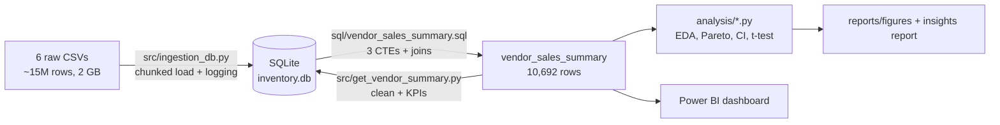
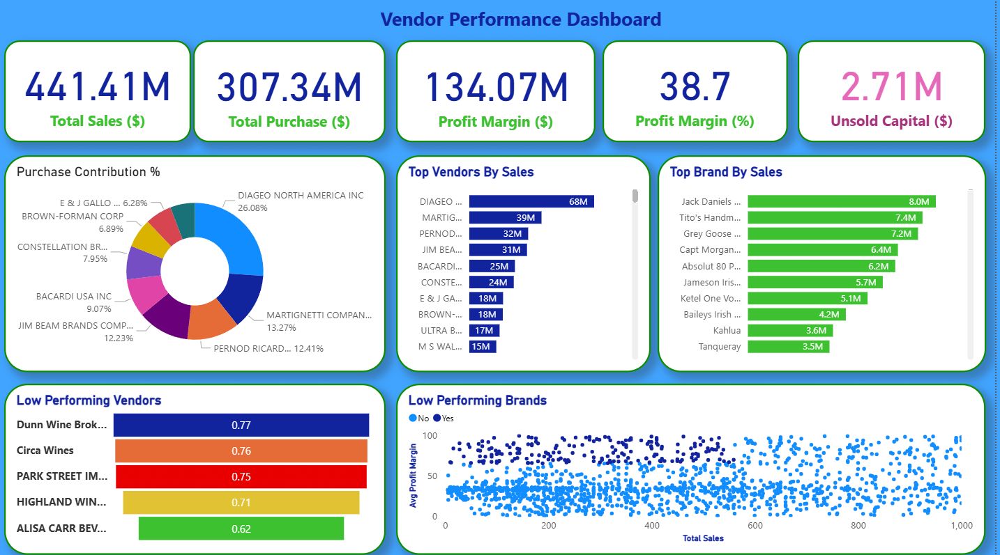
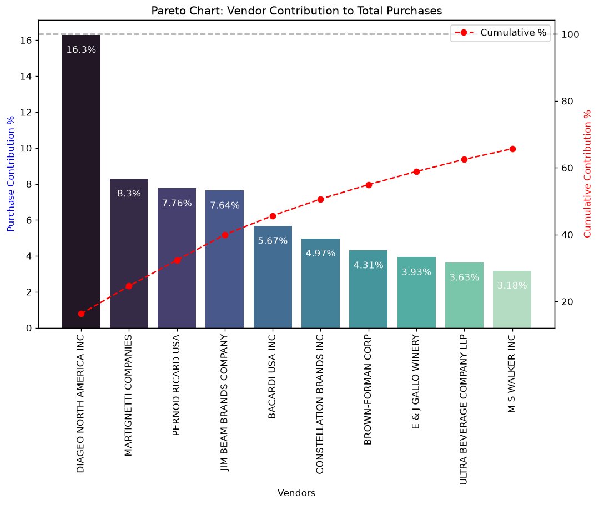
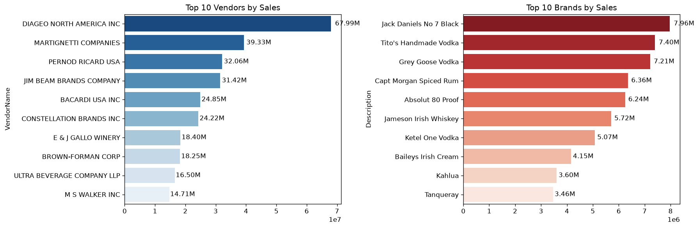
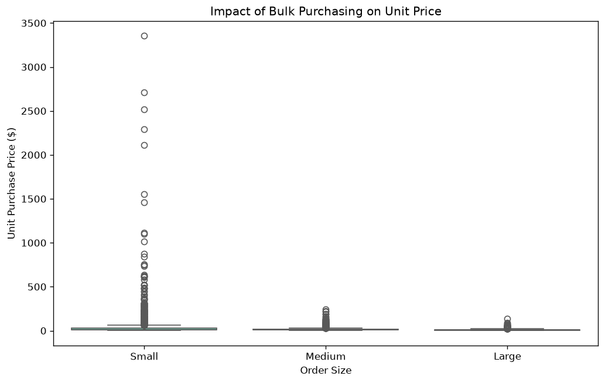
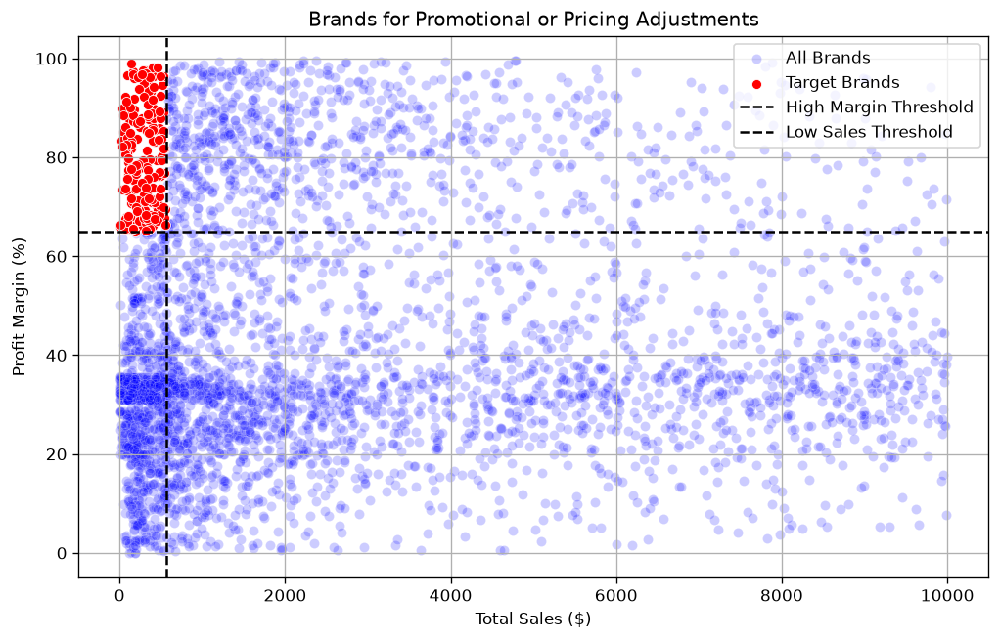

# Vendor Performance Analysis

**SQL · Python (pandas, SciPy) · SQLite · Power BI**

An end-to-end analytics project for a multi-store wine & spirits retailer: raw purchase, sales, price and invoice data (≈15 million rows, 2 GB) is loaded into SQLite, condensed with SQL into a vendor-level KPI table, analysed in Python with statistical testing, and presented in a Power BI dashboard for the procurement team.

---

## Business problem
Buying stock is the retailer's biggest cost. Procurement needed answers to:
- Which **vendors and brands** drive sales and profit?
- How **dependent** are we on a few suppliers?
- Does **bulk buying** really lower unit cost?
- Which vendors have **slow-moving stock**, and how much **cash is tied up** in unsold inventory?
- Which brands deserve **promotion or price changes**?
- Do high-selling and low-selling products earn **significantly different margins**?

## Key findings (2024 data, 119 vendors, 8,564 profitable vendor-product lines)
| Area | Finding |
|---|---|
| Scale | $441.4M sales · $307.3M purchases · $134.1M gross profit · **30.4% margin** |
| Top performers | Diageo North America leads with $67.99M sales; Jack Daniel's No 7 is the top brand ($7.96M) |
| Supplier concentration | **Top 10 vendors = 65.69% of purchase spend** (Diageo alone 16.3%) → concentration risk |
| Bulk buying | Large orders cost **$10.78/unit vs $39.07** for small orders → **~72% lower unit cost** |
| Locked capital | **$2.71M** tied up in unsold inventory; Diageo ($722K), Jim Beam ($555K), Pernod Ricard ($471K) top the list |
| Slow movers | 4,228 lines sold less than they bought (turnover < 1); lowest: Alisa Carr Beverages (0.62) |
| Pricing opportunity | **198 brands** sit in the bottom 15% of sales but top 15% of margin → candidates for promotion |
| Statistics | Low sellers' mean margin 41.6% (95% CI 40.5–42.6) vs top sellers 31.2% (CI 30.7–31.6); Welch's t-test t = −17.67, **p < 0.001** |

Full write-up with recommendations: [reports/insights_report.md](reports/insights_report.md)

## Pipeline


**KPIs standardised in the summary table**

| KPI | Formula |
|---|---|
| Gross Profit | Sales $ − Purchase $ |
| Profit Margin % | Gross Profit ÷ Sales $ × 100 |
| Stock Turnover | Units sold ÷ Units purchased |
| Sales-to-Purchase Ratio | Sales $ ÷ Purchase $ |
| Unsold Inventory Value | (Units purchased − Units sold) × Purchase price |

## Dashboard


One-page Power BI report ([dashboard/Vendor_Performance_Dashboard.pbix](dashboard/Vendor_Performance_Dashboard.pbix)): KPI cards (sales, purchases, gross profit, margin, unsold capital), purchase-share donut for the top 10 vendors, top vendors and top brands bars, a funnel of the lowest-turnover vendors, and a scatter that highlights low-sales / high-margin brands.

## Selected charts
| | |
|---|---|
|  |  |
|  |  |

## Repository structure
```
├── src/
│   ├── config.py                 # project paths
│   ├── ingestion_db.py           # CSV -> SQLite (chunked, logged)
│   └── get_vendor_summary.py     # builds vendor_sales_summary + KPIs
├── sql/vendor_sales_summary.sql  # the aggregation query (CTEs)
├── analysis/                     # VS Code "# %%" scripts (source of truth)
│   ├── 01_data_exploration.py
│   └── 02_vendor_performance_analysis.py
├── notebooks/                    # same analysis rendered with outputs (generated)
├── dashboard/                    # Power BI report + preview
├── reports/                      # insights report + saved figures
├── docs/                         # project guide & interview prep
├── data/README.md                # how to get the raw data
└── requirements.txt
```

## How to run
```bash
python -m venv .venv
.venv\Scripts\activate            # macOS/Linux: source .venv/bin/activate
pip install -r requirements.txt

# 1. put the 6 CSVs in data/ (see data/README.md), then load them (~10 min)
python src/ingestion_db.py

# 2. build the vendor summary table (~30 s)
python src/get_vendor_summary.py

# 3. run the analysis (charts saved to reports/figures/)
python analysis/02_vendor_performance_analysis.py
```
In VS Code you can also open the `analysis/*.py` files and use **Run Cell** on each `# %%` block.
To refresh the rendered notebooks:
```bash
jupytext --to notebook --output notebooks/02_vendor_performance_analysis.ipynb analysis/02_vendor_performance_analysis.py
jupyter nbconvert --to notebook --execute --inplace notebooks/02_vendor_performance_analysis.ipynb
```

## Data-quality fixes made in the pipeline
- **Freight over-count fixed:** vendor freight was originally copied onto every product row, inflating total freight from $1.64M to $656.8M. It is now allocated to products by share of purchase dollars, so totals reconcile with invoices.
- Division-by-zero KPIs (products with no sales) are stored as blank instead of `-inf`.
- Gross profit rounded to cents so floating-point noise doesn't count break-even lines as profitable.
- Hard-coded local paths removed; large CSVs are ingested in 500K-row chunks.

## Known limitations & next steps
- Dashboard fixes planned:
  - The *Profit Margin (%)* card shows 38.7, a simple average of row-level margins. The sales-weighted margin is 30.4%, from the measure
    `Profit Margin % = DIVIDE(SUM(vendor_sales_summary[GrossProfit]), SUM(vendor_sales_summary[TotalSalesDollars]))`.
  - The *Profit Margin ($)* card is really Gross Profit and should be relabelled.
  - The donut shows each vendor's share of the top-10 total; vendor share of *all* purchases is in the Pareto chart (Diageo 16.3%).
- Analysis is at vendor + product level for one year (2024); no seasonality or store-level breakdown yet.
- Next: vendor lead-time KPI from PO → receiving dates, price variance vs. list price, a vendor scorecard, and automated tests for the pipeline.

## Data source
Bibitor, LLC inventory case-study dataset — a fictional chain of 80 wine & spirits stores (purchases, purchase prices, vendor invoices, sales, beginning & ending inventory), in a version dated 2024. Raw files are not included in this repo because of their size; see [data/README.md](data/README.md).

## License
[MIT](LICENSE)
